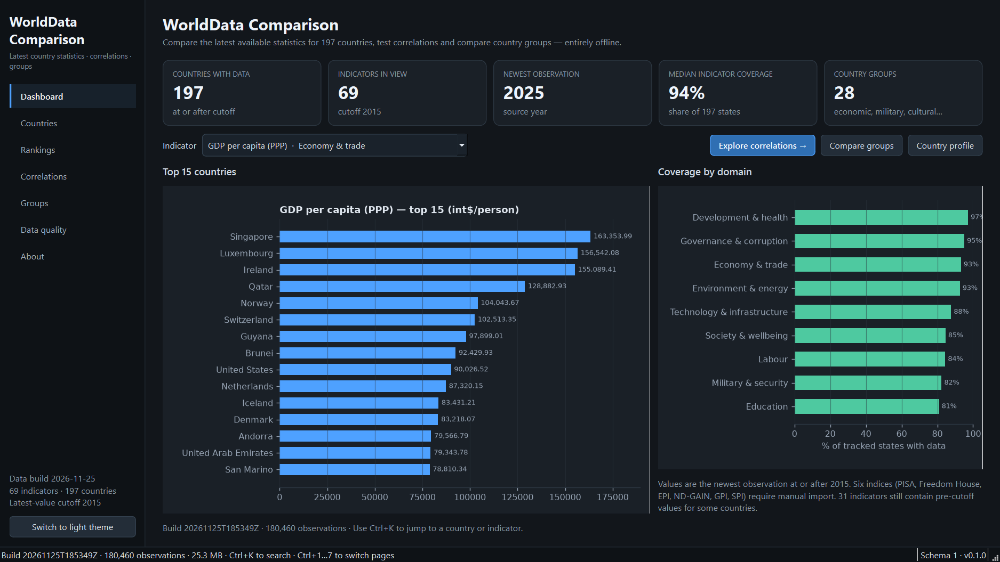
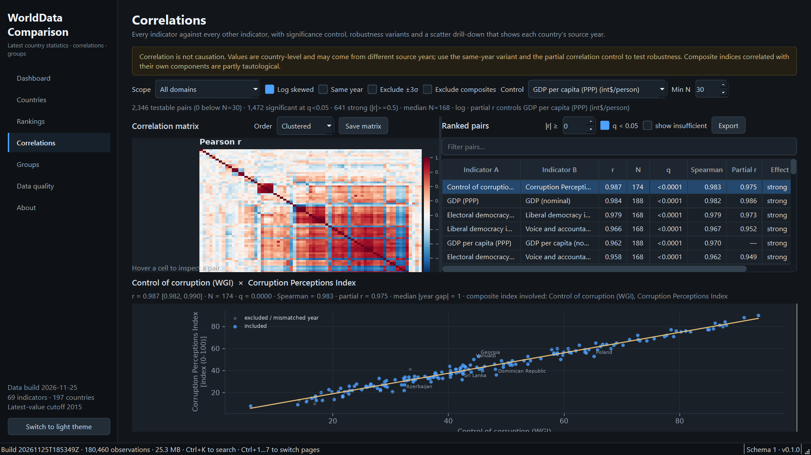
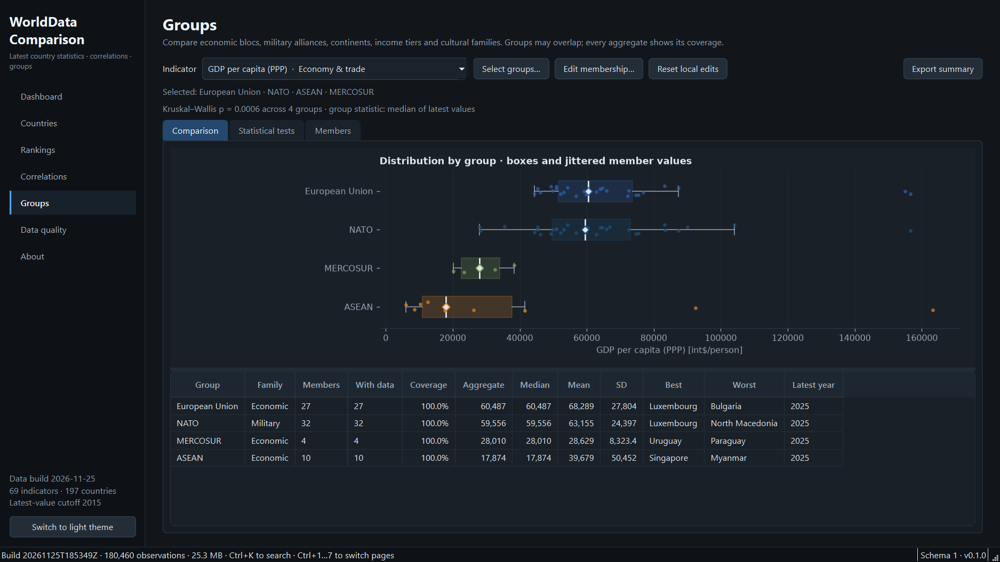
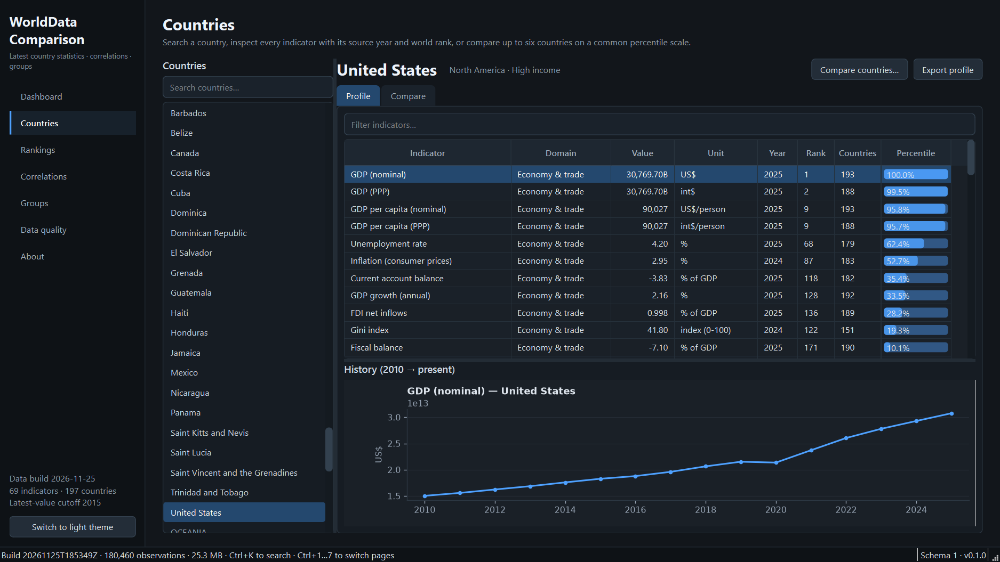
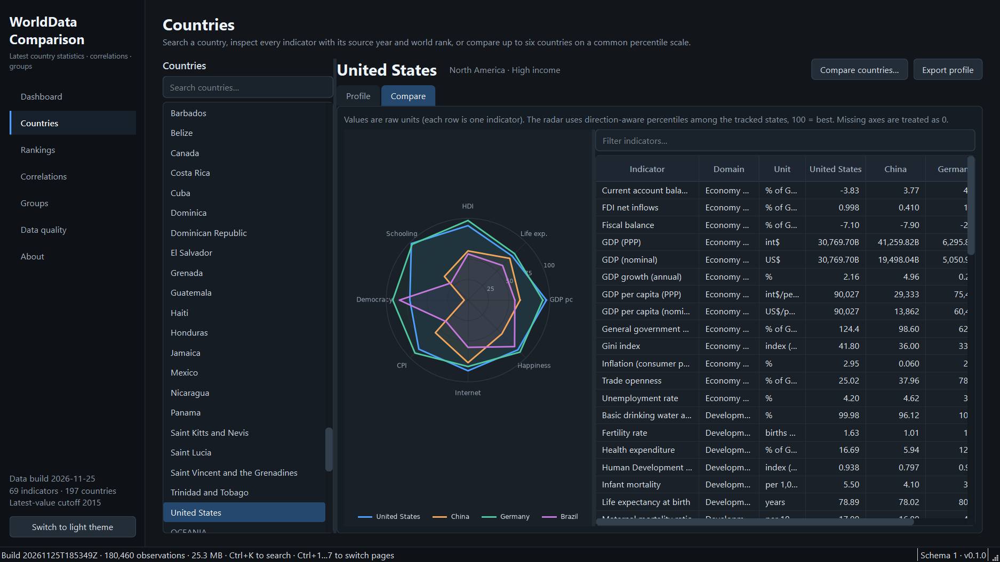
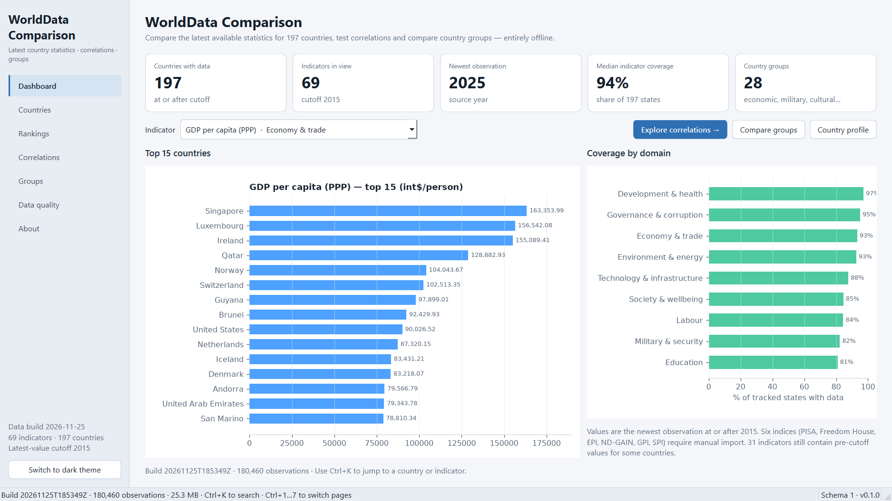

# WorldDataComparison

Offline Windows desktop application for comparing the latest available
statistics of 197 countries, testing **every pairwise correlation**, and
comparing country groups — economic blocs, military alliances, continents,
income tiers and cultural families — with an auditable data pipeline behind it.


<!-- After the first push, enable the CI badge by replacing OWNER/REPO:
[](https://github.com/OWNER/REPO/actions/workflows/ci.yml)
-->



## Contents

- [What it does](#what-it-does)
- [Features](#features)
- [Data at a glance](#data-at-a-glance)
- [Quick start](#quick-start)
- [Using the app](#using-the-app)
- [Keeping data current](#keeping-data-current)
- [Methodology](#methodology)
- [Screenshots](#screenshots)
- [Project structure](#project-structure)
- [Development and tests](#development-and-tests)
- [Packaging](#packaging)
- [Quality gates](#quality-gates)
- [Limitations](#limitations)
- [Roadmap](#roadmap)
- [Contributing](#contributing)
- [Licence and data](#licence-and-data)
- [Citation](#citation)
- [Acknowledgements](#acknowledgements)

## What it does

WorldDataComparison loads a validated SQLite snapshot of country statistics and
lets you explore it entirely offline:

- **Compare countries** on 75 indicators with source years, ranks and
  direction-aware percentile bars.
- **Correlate everything**: 2,346 indicator pairs with Pearson r, N, p, 95%
  confidence intervals, Spearman rho, FDR-adjusted q, log transforms, outlier
  exclusion, strict same-year matching, and partial correlation controlling for
  a confounder such as GDP per capita.
- **Compare groups**: 28 curated groups, coverage-aware aggregates, statistical
  tests and effect sizes, editable membership.
- **Trust the numbers**: every value carries its year, missing data is never
  imputed, quarantined values are reported, and the database is checksum-verified
  at startup.

The app never touches the network. Refreshing data is an explicit CLI step, so
a release can be reproduced and audited.

## Features

**Interface**

- Seven pages: Dashboard, Countries, Rankings, Correlations, Groups,
  Data & Quality, About.
- Searchable country and indicator lists, `Ctrl+K` command palette,
  `Ctrl+1…7` page shortcuts.
- Dark and light themes, high-DPI aware, keyboard-friendly.
- Tables sort, filter, copy (cell/row/table) and export to CSV/XLSX; charts
  export to PNG/SVG/PDF.

**Statistics**

- Latest-value selection with a configurable recency cutoff (default 2015) and
  per-point source years.
- Pearson r with t-based p values and Fisher-z confidence intervals.
- Spearman rho as a monotonicity check.
- Benjamini–Hochberg false-discovery-rate control across all tested pairs.
- Log10 for skewed indicators; ±3σ outlier exclusion; strict same-year mode.
- Partial correlation with a selectable control variable.
- Clustered heatmap, ranked pair table, and scatter drill-down with hover
  details, regression line and labelled residuals.

**Groups**

- 28 groups in 6 families: EU, Eurozone, USMCA, MERCOSUR, ASEAN, BRICS+; NATO,
  CSTO, nuclear states; continents; World Bank income tiers; liberal vs
  non-liberal polities; Slavic, Germanic, Romance, Nordic, Anglophone, Arab
  League and Lusophone groups.
- Per-indicator aggregation: median, sum, mean or population-weighted mean.
- Coverage disclosure (`n with data / n members`) on every aggregate.
- Kruskal–Wallis, pairwise Mann–Whitney with BH correction, Cliff's delta and
  Cohen's d, group-vs-rest comparisons.
- Member drill-down and local membership overrides that survive restarts and
  data swaps.

**Data engineering**

- Config-driven indicator catalogue, sources, countries, aliases and groups.
- Snapshot cache with SHA-256; online refresh, offline rebuild, `--force`.
- Deterministic content hash, schema version and database checksum in the
  manifest; mismatches are refused.
- Range validation and quarantine (`rejected.csv`), unresolved-name reporting
  and skipped-aggregate reporting.
- Derived ratios (military spending per capita, armed forces per 1,000, patents
  per million) with hidden inputs.
- Manual CSV/XLSX import for indices that cannot be redistributed.

## Data at a glance

| Property | Value |
| --- | --- |
| Indicators | 75 visible (69 automated + 6 manual) + 2 hidden inputs |
| Domains | 9 |
| Default entities | 197 (193 UN members + Vatican, Palestine, Taiwan, Kosovo) |
| Extra entities | 22 dependent territories, hidden by default |
| Observations | 180,460 |
| Years | 2010 → 2025 (latest year depends on the source) |
| Snapshot | Build `20261125T185349Z`, schema 1, 25.3 MB SQLite |
| Correlations | 2,346 pairs for the default 69-indicator run |
| Groups | 28 groups in 6 families |
| Automated sources | World Bank WDI/WGI, IMF WEO, Our World in Data |
| Manual sources | PISA, Freedom House, Yale EPI, ND-GAIN, IEP GPI, Social Progress Index |

Coverage: **69 of 69 automated indicators reach at least 60% of the 197
states**; zero duplicate keys, zero out-of-range rows and zero unresolved
source names. Per-indicator numbers are in
[docs/INDICATORS.md](docs/INDICATORS.md).

## Quick start

### Portable build (no Python required)

1. Download the release zip (`WorldDataComparison-0.1.0.zip`, about 110 MB).
2. Extract it outside `Program Files` so the app can save settings and group
   edits.
3. Run `WorldDataComparison.exe`.

The folder contains the executable, the Qt runtime, the database, its manifest
and the source licences. See [USAGE](docs/USAGE.md) for a page-by-page guide.

### From source

Requires Python 3.11+ (3.13 recommended). The source is cross-platform, but the
packaged build is Windows-only.

```powershell
# from the repository root
python -m pip install -e .

# download ~70 series and build data/worlddata.sqlite (needs internet)
python scripts/refresh_data.py

# launch
python -m worlddata.ui.app
```

For development, install the extras:

```powershell
python -m pip install -e ".[dev,build]"
```

## Using the app

| Page | What it is for |
| --- | --- |
| **Dashboard** | Coverage KPIs, newest source year, top-15 ranking, domain coverage |
| **Countries** | Searchable profiles, world ranks, percentile bars, 2010→present sparklines, up to six-country comparison with a percentile radar |
| **Rankings** | One indicator across all countries, region/income filters, histogram, export |
| **Correlations** | Full pairwise matrix, ranked table, scatter drill-down and robustness toggles |
| **Groups** | Group distributions, aggregates, tests, effect sizes, membership editing |
| **Data & Quality** | Coverage, missing counts, sources, quarantined rows, cutoff and territory settings |
| **About** | Build metadata, methodology, caveats and attribution |

Full walkthrough: [docs/USAGE.md](docs/USAGE.md).

## Keeping data current

```powershell
python scripts/refresh_data.py                 # fetch (or reuse today's cache) + rebuild
python scripts/refresh_data.py --force         # ignore the daily cache
python scripts/build_db.py                     # offline rebuild from cached snapshots
python scripts/validate_data.py --strict       # checksum + quality gates
python scripts/import_manual.py --indicator pisa_math --file pisa.csv
```

**Swapping data without code changes:** replace `data/worlddata.sqlite` and
`data/manifest.json` together (close the app first). The manifest's schema
version and the database SHA-256 are checked at startup; a mismatch is refused
instead of loading inconsistent data. Settings and local group edits live in
`data/settings.json` and `data/groups.local.yaml` and are preserved.

Raw snapshots live in `data/raw/<source>/<date>/` and allow a full offline
rebuild. They are not committed to git; the release asset carries the validated
snapshot. See [docs/DATA.md](docs/DATA.md) for sources, the manual-import
schema, quarantine rules and the full data lifecycle.

The EIU Democracy Index is commercially licensed and is **not** bundled. It can
be added privately through a manual indicator entry; see
[docs/DATA.md](docs/DATA.md#manual-imports).

## Methodology

**Latest values.** Each country × indicator uses the newest observation at or
after the recency cutoff (default 2015). The source year is shown everywhere.
Missing values are never imputed or zero-filled. History from 2010 onward is
retained for the same-year robustness mode and sparklines.

**Correlations.** Pairwise-complete observations with N ≥ 30 by default.
Pearson r, two-tailed p, Fisher-z 95% CI, Spearman rho, and BH-FDR q across all
pairs in a run. Optional log10, ±3σ exclusion, same-year matching and partial
correlation. The heatmap is ordered by hierarchical clustering of `1 − |r|` for
readability only.

**Groups.** Aggregation follows the indicator: totals are summed, rates and
per-capita values use the median, and shares marked `weighted` use a
population-weighted mean. Every group reports its data coverage. Tests are
two-sided Mann–Whitney U with BH correction; effect sizes are Cliff's delta and
Cohen's d.

**What the numbers do not show.** Correlation is not causation. Country-level
(“ecological”) correlations do not describe individuals. Composite indices
correlated with their own components are partly tautological and are flagged.
Publication years differ; use the year-gap column and the same-year mode.

**Privacy and affiliation.** The app contains no telemetry and makes no network
requests at runtime. It is an independent project and is not affiliated with or
endorsed by the World Bank, IMF, United Nations, Our World in Data, Transparency
International, V-Dem or any other data provider. Figures are provided as-is;
verify material claims against the upstream source.

## Screenshots

| | |
| --- | --- |
|  |  |
| All-pairs matrix, ranked pairs and scatter drill-down | Group distributions with coverage-aware aggregates |
|  |  |
| Country profile with ranks and percentile bars | Up to six countries on a common percentile scale |

The light theme is available from the sidebar:


## Project structure

```
config/                    sources, indicators, countries, aliases, groups (YAML)
src/worlddata/
  ingest/                  World Bank, IMF, OWID and manual-import fetchers
  normalize.py             alias resolution, ranges, derived ratios, quarantine
  build.py                 fetch → normalize → SQLite → coverage → gates
  db.py                    schema, manifest/checksum verification, repository
  core/                    dataset, statistics, correlations, groups, views, export
  ui/                      PySide6 shell, seven pages, models, charts, theme
scripts/                   refresh / build / validate / import wrappers
tests/                     unit, synthetic-build, real-data and Qt smoke tests
docs/                      usage, data, architecture, generated catalogues, FAQ
tools/                     doc generator, country registry generator, UI screenshots
```

## Development and tests

```powershell
python -m pip install -e ".[dev,build]"
python scripts/refresh_data.py
python -m ruff check src scripts tests
python -m pytest -q
```

- 86 tests: statistics against SciPy references, synthetic end-to-end builds,
  manifest integrity, golden values, statistical sign checks and an offscreen
  Qt smoke test.
- Integration and UI tests skip automatically when no database is present, so a
  fresh clone can run the suite without a network.
- CI runs lint and tests on Windows with Python 3.11 and 3.13
  (`.github/workflows/ci.yml`).

Details: [docs/DEVELOPMENT.md](docs/DEVELOPMENT.md) and
[CONTRIBUTING.md](CONTRIBUTING.md).

## Packaging

```powershell
powershell -ExecutionPolicy Bypass -File build.ps1
```

The script lints, tests, builds with PyInstaller (onedir), runs the packaged
`--selftest`, assembles the portable layout (`config/` and `data/` beside the
exe), and writes `dist\WorldDataComparison-<version>.zip`.

- Uncompressed bundle: ~283 MB (PySide6, SciPy, pandas, matplotlib).
- Zip: ~110 MB.
- Startup to a visible window: ~5 s; the default correlation run takes ~2.5 s
  in a worker thread.
- Unused Qt modules (Quick/QML/Pdf/OpenGL), translations and `pycountry` are
  stripped from the frozen app.

The executable is unsigned, so Windows SmartScreen may warn on first launch.

## Quality gates

`validate_data.py --strict` fails when:

- fewer than 50 automated indicators have ≥60% country coverage
  (current: 69/69);
- duplicate `(iso3, indicator, year)` keys exist;
- values are non-finite;
- more than 1% of source rows fail country resolution (current: 0%);
- observations are dated more than one year into the future.

Quarantined values, unresolved names and skipped aggregates are written to
`data/rejected.csv`, `data/unresolved.csv` and `data/skipped_entities.csv` —
nothing is silently dropped.

## Limitations

- Country-level correlations do not describe individuals and do not prove
  causation.
- Different indicators publish in different years; the same-year mode is a
  robustness check, not a harmonised panel.
- Some series are sparse by nature (Gini surveys, literacy, hospital beds,
  PISA, working hours). Coverage is always visible.
- Taiwan, Kosovo and Palestine have gaps because not every source publishes
  them.
- No choropleth map or full historical trend page yet; both are on the
  roadmap in [CHANGELOG.md](CHANGELOG.md).
- The portable build is Windows-only; the source runs elsewhere but is not
  packaged or tested there.
- The dataset is a snapshot. Upstream revisions change values; record the
  build id when sharing results.

## Roadmap

Near-term work is tracked in [ROADMAP.md](ROADMAP.md): a choropleth map, a
history/trend view, selector-group membership at the current cutoff,
multiple-control partial correlation, report export, an installer, code
signing, and cross-platform packaging. The changelog lists what is already
planned per release.

## Contributing

Issues and pull requests are welcome. Start with
[CONTRIBUTING.md](CONTRIBUTING.md), follow the
[Code of Conduct](CODE_OF_CONDUCT.md), and report security problems privately
per [SECURITY.md](SECURITY.md). For questions, see [SUPPORT.md](SUPPORT.md).

Useful references:

- [Data guide](docs/DATA.md)
- [Architecture](docs/ARCHITECTURE.md)
- [Developer guide](docs/DEVELOPMENT.md)
- [FAQ](docs/FAQ.md)
- [Release checklist](docs/RELEASING.md)
- [Generated indicator catalogue](docs/INDICATORS.md)
- [Generated group catalogue](docs/GROUPS.md)

## Licence and data

The application source code is released under the [MIT Licence](LICENSE).

**The data is not covered by the MIT licence.** Each source has its own terms;
see [NOTICE.txt](NOTICE.txt) and `config/sources.yaml`. OWID-delivered series
keep their upstream terms (for example V-Dem CC BY-SA 4.0 and Transparency
International's CPI terms). The six manual indices and the EIU Democracy Index
are not redistributed by this project.

## Citation

If you use this software in academic or analytical work, cite it using
[CITATION.cff](CITATION.cff). When publishing results, include the data build
id from the status bar or `data/manifest.json` so the snapshot is
reproducible.

## Acknowledgements

Data: World Bank (WDI and WGI), International Monetary Fund (WEO), Our World in
Data and its upstream producers (UNDP, V-Dem, Transparency International, RSF,
WHO, UNODC, UN WPP, Gallup/WHR, International IDEA, Penn World Table).

Built with PySide6, pandas, NumPy, SciPy, matplotlib, pydantic and PyInstaller.
