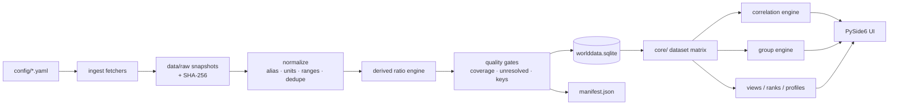

# Architecture

WorldDataComparison is a local-first desktop analytics tool. The design keeps
the statistical core free of GUI dependencies, treats the dataset as an
immutable, self-describing artifact, and makes the UI a replaceable consumer of
that core.

## Design goals

1. **Offline and deterministic.** A validated SQLite file plus a manifest is
   the runtime artifact. The app never fetches data.
2. **Config over code.** Indicators, sources, countries, aliases and groups are
   YAML files; adding a series is normally a config change plus a fetcher
   mapping.
3. **Auditable numbers.** Every value carries its source year, coverage is
   reported, and missing data is never imputed.
4. **No silent failures.** Out-of-range values, unresolved countries and
   skipped aggregates are quarantined and reported; data corruption is refused.
5. **Replaceable UI.** `core/` has no Qt imports and can back a CLI, notebook or
   web UI.

## Pipeline



Build entry points:

- Online: `scripts/refresh_data.py` → `worlddata.build.build(offline=False)`.
- Offline: `scripts/build_db.py` → `worlddata.build.build(offline=True)`.
- Validation: `scripts/validate_data.py` → `worlddata.quality.evaluate_gates`.

## Module map

| Path | Responsibility |
| --- | --- |
| `config.py` | Pydantic contracts for sources, indicators, countries, groups, aliases |
| `countries.py` | Canonical registry, alias normalisation and resolution |
| `paths.py` | Source, portable and frozen (`_internal`) directory resolution |
| `ingest/base.py` | HTTP client, retries, snapshot cache, SHA-256 sidecar metadata |
| `ingest/worldbank.py` | WDI and WGI API fetcher with pagination and daily cache reuse |
| `ingest/imf.py` | IMF DataMapper fetcher; projections capped |
| `ingest/owid.py` | OWID grapher CSV fetcher with explicit value-column selection |
| `ingest/manual.py` | CSV/XLSX import, canonicalisation, snapshot writing |
| `normalize.py` | ISO3 resolution, range validation, deduplication, derived ratios, quarantine |
| `quality.py` | Coverage report, quality gates, generated artifacts |
| `build.py` | Orchestration, group materialisation, manifest writing |
| `db.py` | Schema, writers, manifest verification, read-only repository |
| `core/dataset.py` | Latest-value and year matrices, country/indicator metadata |
| `core/stats.py` | Pearson/p, Fisher CI, Spearman, BH-FDR, partial residuals, group tests |
| `core/correlations.py` | Pairwise engine, variants, matrix, clustering, scatter points |
| `core/groups.py` | Membership resolution, aggregation, tests, overlays |
| `core/views.py` | Rankings, profiles, comparisons, coverage views |
| `core/export.py` | CSV/XLSX and figure export |
| `ui/context.py` | Repository + cached datasets + group set + settings |
| `ui/main_window.py` | Sidebar, page stack, command palette, theme |
| `ui/pages/*` | One page per section |
| `ui/models.py`, `ui/widgets.py` | Pandas-backed table models, charts, pickers, task runner |
| `ui/theme.py` | QSS, palette, matplotlib styling |

## Database schema

SQLite, schema version 1. The file is read-only at runtime.

```
meta(key, value)
source(id, name, homepage, license, attribution, redistributable)
country(iso3 PK, name, official_name, entity_type, un_member, region,
        subregion, continent, income_group, is_default)
country_alias(alias, source_id, iso3)            -- resolved name → ISO3
indicator(id PK, name, domain, description, unit, source_id, series,
          higher_is_better, default_log, is_composite, hidden,
          aggregation, valid_min, valid_max, attribution)
observation(iso3, indicator_id, year, value, source_id, retrieved_at)
          PRIMARY KEY(iso3, indicator_id, year) WITHOUT ROWID
coverage(indicator_id PK, n_countries, pct, min_year, max_year, latest_year)
"group"(id PK, name, family, description, color, origin)
group_member(group_id, iso3)
```

Indexes: `observation(indicator_id, year)` and `observation(iso3, year)`.

Notes:

- `observation.value` is stored in the declared unit (percent values are
  0–100, currencies as published).
- `coverage` counts the default state set only (197), not territories.
- `group_member` is materialised at build time. Selector-based groups are
  evaluated against the build-time cutoff; the UI's cutoff changes do not
  rewrite membership.
- `meta.content_hash` is a deterministic hash over all observation rows;
  `manifest.db_sha256` covers the database file itself.

## Latest-value matrix

`core.dataset.load_dataset(repo, cutoff)` loads observations once and pivots:

- `values`: countries × indicators, newest value at or after the cutoff.
- `years`: the same shape with source years.
- `countries` and `indicators`: metadata frames.

SQL uses `ROW_NUMBER() OVER (PARTITION BY iso3, indicator_id ORDER BY year
DESC)` and keeps row 1. No `latest` table is materialised, so changing the
cutoff never requires a rebuild.

The dataset is cached in `AppContext` by `(cutoff, include_territories,
extra_indicators)`; invalidation clears all derived caches.

## Correlation engine

Inputs: the value matrix and the year matrix. Options are captured in an
immutable `CorrOptions` value object whose `key` is used for caching.

Per pair:

1. Build the complete-case mask (both values finite; same year if requested;
   control finite if partial correlation is requested).
2. Optionally remove rows with |z| > 3 on either variable.
3. Compute Pearson r and the two-tailed p value from the t distribution.
4. Compute the 95% CI via Fisher z: `tanh(atanh(r) ± 1.96/√(n−3))`.
5. Compute Spearman rho as a monotonicity check.
6. If a control is set and is not one of the pair variables, residualise both
   variables on `[1, control]` by least squares and compute Pearson r on the
   residuals.
7. Record N, outlier count, median absolute year gap and an effect band.

After all pairs, Benjamini–Hochberg FDR is applied over the tested p values.
Pairs below `min_n` are retained but marked insufficient so the UI can show
them on request. The matrix is assembled as a symmetric frame; clustering uses
average linkage on `1 − |r|` for display ordering only.

Threading: the computation runs in `QThreadPool` via `TaskRunner`; a generation
counter discards results from superseded option changes.

## Group engine

- Membership is a many-to-many map (`group_member`) plus an optional local YAML
  overlay. Overlays may replace a group's member list entirely; unknown codes
  are filtered.
- Aggregation is declared per indicator (`median`, `mean`, `sum`,
  `weighted`). Weighted shares use population as the weight.
- Group comparisons use two-sided Mann–Whitney U with BH correction across the
  tests in the run, Cliff's delta and Cohen's d (pooled SD). Kruskal–Wallis is
  reported across the selected groups.
- “Rest of world” excludes all members of all selected groups.
- Every aggregate is accompanied by `n_data / n_members`, and a group with no
  data for the indicator is omitted from the chart but kept in the table.

## UI architecture

- `AppContext` owns the read-only repository, the cached dataset, the group set
  and settings. Pages never open SQLite directly.
- Each page is a `QWidget` with `on_show()` and `on_theme_changed()` hooks.
  `MainWindow.navigate()` calls `on_show()`; pages build their frames lazily
  from the shared dataset.
- Tables use `QAbstractTableModel` over pandas frames plus a sorting/filtering
  proxy; percentile bars are painted by a delegate.
- Charts are embedded matplotlib figures (`FigureCanvasQTAgg`). Matplotlib
  rcParams and the QSS palette are switched together for dark/light themes.
- Heavy work (correlations) runs on a worker thread; the UI mutates widgets only
  on the main thread.
- Settings and group overlays are written to the portable `data/` folder with an
  `%APPDATA%` fallback for settings.

Page responsibilities:

| Page | Primary core calls |
| --- | --- |
| Dashboard | `views.rank_table`, `views.domain_coverage` |
| Countries | `views.country_profile`, `views.compare_table`, `views.compare_percentiles` |
| Rankings | `views.rank_table`, `views.indicator_summary` |
| Correlations | `correlations.correlation_pairs`, `matrix_from_pairs`, `cluster_order`, `pair_points` |
| Groups | `groups.summarize`, `compare`, `member_table`, overlay helpers |
| Data & Quality | `quality_report.csv`, `repository.sources`, diagnostics CSVs |

## Packaging and path resolution

- PyInstaller onedir, windowed, `contents_directory` left at the default
  `_internal`; `build.ps1` copies `config/` and `data/` beside the executable
  and removes the duplicate `_internal` copies.
- `paths._base_dir()` prefers the executable folder when it contains both
  `config/` and `data/`; otherwise it falls back to `_internal/` (raw
  PyInstaller output) and finally the executable folder.
- `WORLDDATA_BASE_DIR`, `WORLDDATA_CONFIG_DIR` and `WORLDDATA_DATA_DIR` override
  the layout for development and tests.
- The frozen app supports `--selftest` (construct and render every page, exit
  non-zero on failure) and writes `selftest.log` beside the executable. Source
  runs honour `WDC_DEBUG=1`.
- Source runs resolve the project root from the package location, so no install
  step is required beyond dependencies.

## Failure handling

| Failure | Behaviour |
| --- | --- |
| Missing/corrupt DB or bad checksum | Startup dialog, no partial load |
| Newer schema | Refuse to load, instructs to update the app or rebuild |
| Broken upstream series | That series fails; the rest of the build continues; the error is printed and reflected in coverage |
| Unknown country name | Quarantined to `unresolved.csv`; gate fails above 1% |
| Out-of-range value | Quarantined to `rejected.csv`; never clamped |
| Duplicate observation | Deterministic dedupe by `(iso3, indicator, year)` |
| Read-only portable folder | Settings fall back to `%APPDATA%`; group edits show an explanation |
| Non-redistributable source | Excluded from public bundles via the source flag |

## Performance

- Startup to a visible window: ~5 s in the packaged build (PySide6 + SciPy +
  pandas import cost); ~1–2 s from a warm source run.
- Default correlation run: 2,346 pairs with partial correlations in ~2.5–3 s on
  a desktop CPU; cached per option set.
- Dataset load: 180k rows → 197×69 matrices in well under a second.
- Table rendering uses models, not per-cell widgets; 197-row tables are
  instant.

## Trade-offs

- **SQLite over DuckDB/Parquet:** simpler packaging, no extra native engine,
  and the analysis is small enough for pandas.
- **Latest-value matrix over SQL analytics:** keeps the statistical core
  testable and fast, at the cost of materialising a small pivot in memory.
- **Config materialisation of selector groups:** reproducible builds, but
  membership does not follow a later cutoff change. Documented.
- **World-only Windows packaging:** the source is cross-platform, but only the
  portable Windows artifact is supported and tested in CI/release.
- **Bundle size:** PySide6 + SciPy + pandas + matplotlib dominate; unused Qt
  modules and pycountry are stripped, but the uncompressed bundle remains
  ~283 MB.
