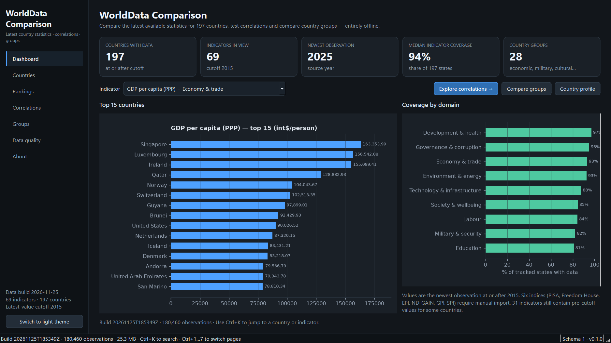
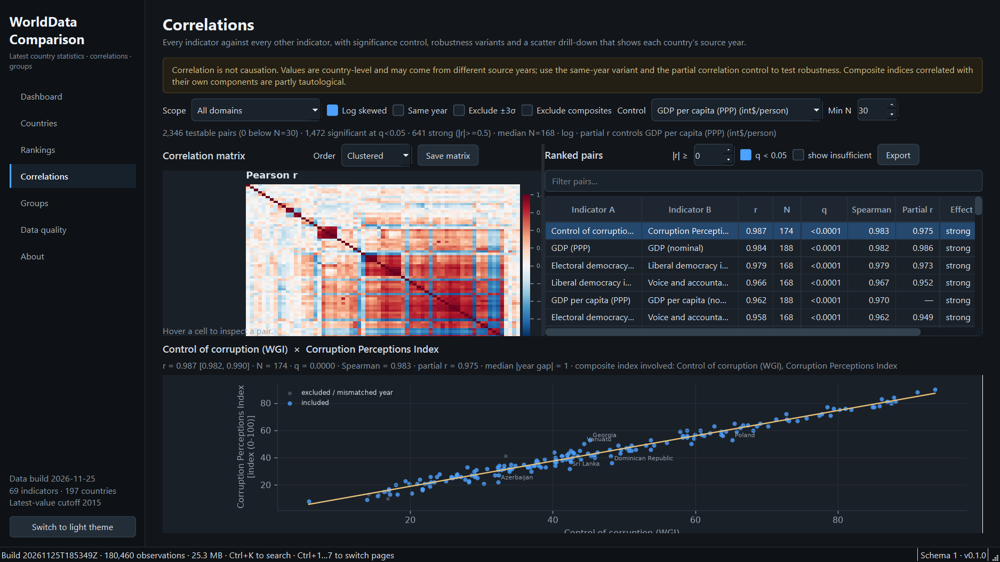
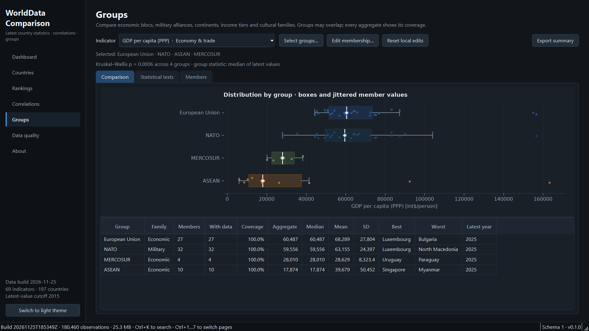
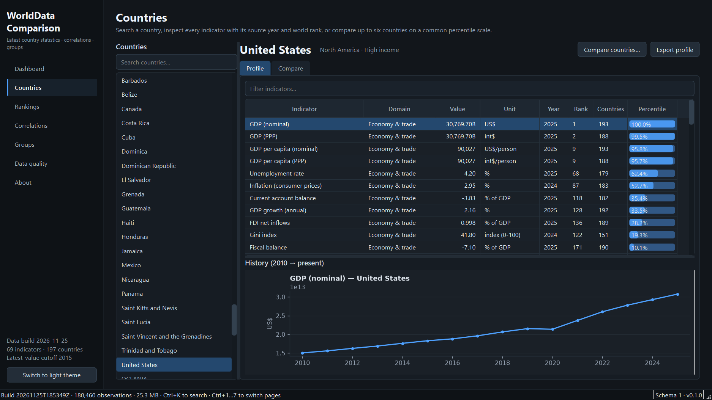

# Documentation

Start here depending on what you need:

| Document | For |
| --- | --- |
| [README](../README.md) | Overview, features, install, quick start, screenshots |
| [USAGE](USAGE.md) | Page-by-page guide to every control in the app |
| [DATA](DATA.md) | Sources, refresh, manual imports, coverage, data swapping |
| [INDICATORS](INDICATORS.md) | Generated catalogue of all 75 indicators with coverage |
| [GROUPS](GROUPS.md) | Generated catalogue of the 28 country groups |
| [ARCHITECTURE](ARCHITECTURE.md) | Code layout, database schema, analysis pipeline |
| [DEVELOPMENT](DEVELOPMENT.md) | Local setup, tests, packaging, debugging |
| [RELEASING](RELEASING.md) | GitHub release checklist and repository settings |
| [FAQ](FAQ.md) | Common questions, caveats and troubleshooting |
| [ROADMAP](../ROADMAP.md) | Planned and explicitly out-of-scope work |
| [SUPPORT](../SUPPORT.md) | Where to ask questions and report problems |
| [CONTRIBUTING](../CONTRIBUTING.md) | How to contribute code, data or docs |
| [CODE OF CONDUCT](../CODE_OF_CONDUCT.md) | Community expectations |
| [SECURITY](../SECURITY.md) | Reporting vulnerabilities |
| [CHANGELOG](../CHANGELOG.md) | Version history |
| [NOTICE](../NOTICE.txt) | Third-party data attribution and licences |

## Screenshots

| | |
| --- | --- |
|  |  |
| Dashboard: coverage, newest observation, top-15 ranking | All-pairs correlation matrix and ranked pairs |
|  |  |
| Group distributions with coverage-aware aggregates | Country profile with rank and percentile bars |

The interface ships with a dark theme by default and a light theme toggle in
the sidebar.
