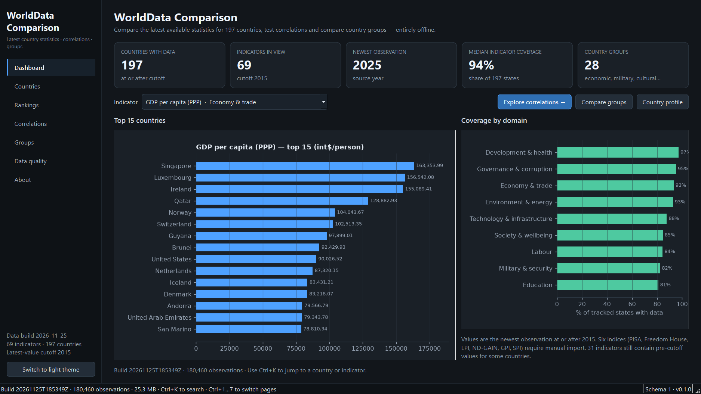
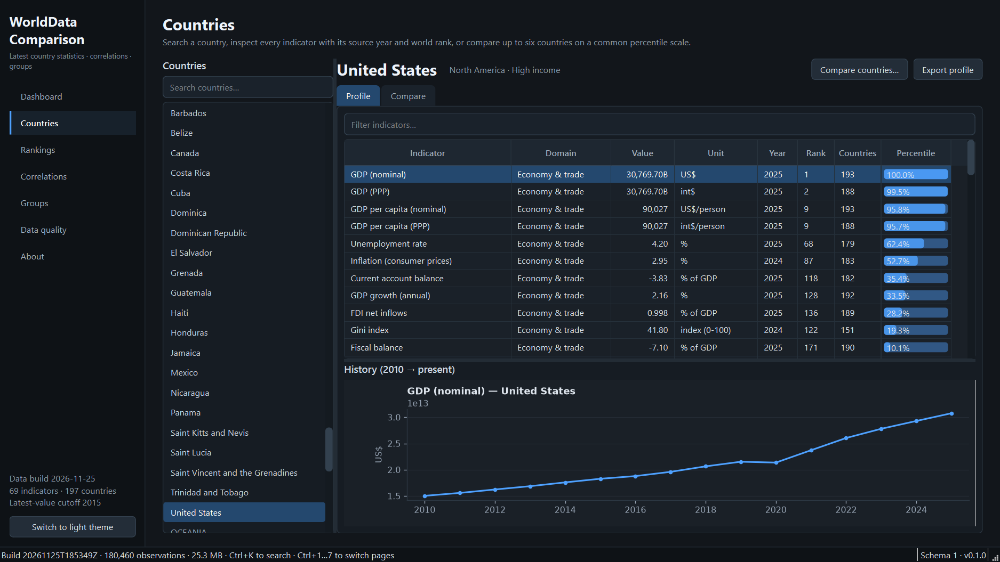
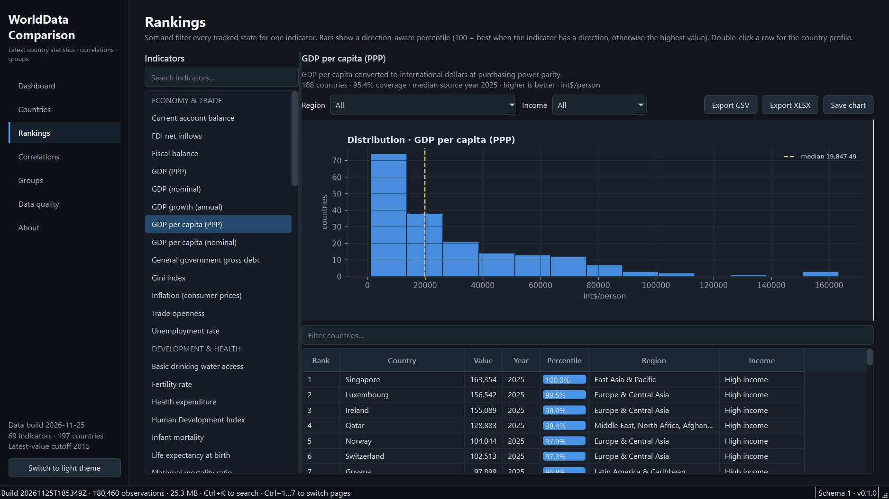
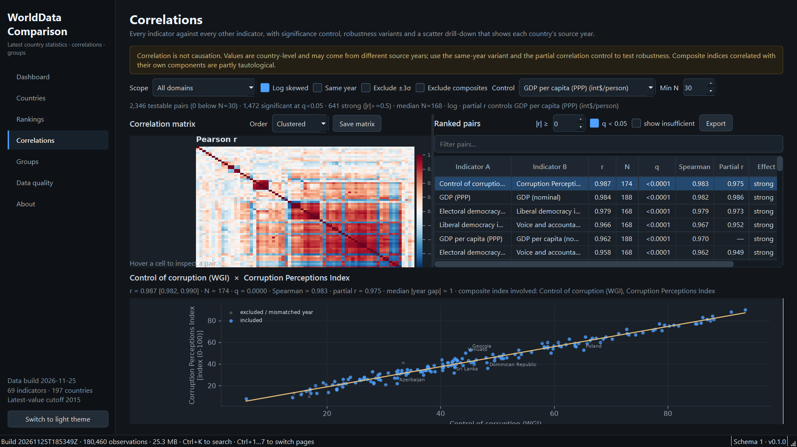
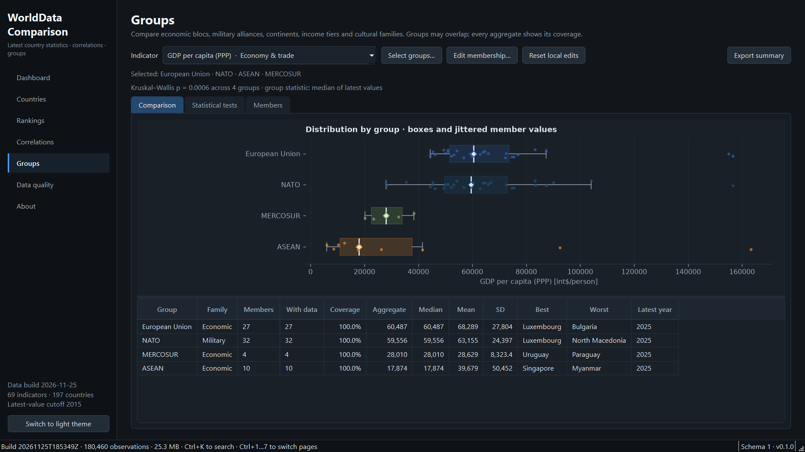
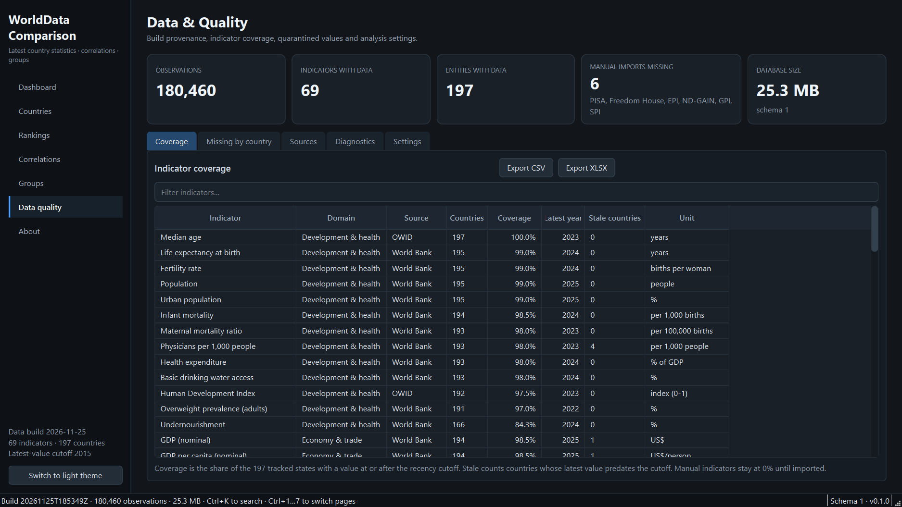

# Usage guide

This guide walks through the application page by page. For installation, see
the [README](../README.md); for the data model, see [DATA](DATA.md).

## Starting the app

- **Portable build:** extract `WorldDataComparison-<version>.zip` outside
  `Program Files` (the app writes settings and group edits into its `data/`
  folder), then run `WorldDataComparison.exe`.
- **From source:** `python -m worlddata.ui.app`.

The app never needs the network. Data is loaded from `data/worlddata.sqlite`
and validated against `data/manifest.json` on startup.

## Window layout

- **Sidebar:** Dashboard, Countries, Rankings, Correlations, Groups, Data
  quality, About. The footer shows the data build date, indicator/country
  counts and the latest-value cutoff.
- **Status bar:** build id, observation count, database size, keyboard hints,
  schema version.
- **Search:** `Ctrl+K` opens a palette that searches both countries and
  indicators. `Ctrl+1…7` switches pages.
- **Theme:** the sidebar button toggles dark/light. The choice is persisted.

The data snapshot is fixed; the app never downloads updates at runtime. Run the
refresh scripts to make a new snapshot, then swap it in (see [DATA](DATA.md)).

## Dashboard

- **KPI cards:** countries with data, indicators in view, newest source year,
  median indicator coverage, number of groups.
- **Indicator picker:** any indicator with data at the current cutoff.
- **Top 15 chart:** uses the newest observation per country at or after the
  cutoff. The unit and source year are shown.
- **Coverage by domain:** mean indicator coverage per domain.
- **Footer:** build id and observation count.

Use the quick buttons to jump to Correlations, Groups, or a country profile.

## Countries

- **Country list:** grouped by continent, searchable. `Ctrl+K` works from any
  page.
- **Profile table:** every indicator with a value, its unit, **source year**,
  world rank, number of countries with data, and a direction-aware percentile
  bar. A bar of 100 means best when the indicator has a better direction; for
  neutral indicators it means the highest value.
- **History:** selecting a profile row plots the retained 2010→present series
  for that indicator. This is a history view, not a trend forecast.
- **Compare countries…:** choose 2–6 countries. The Compare tab shows:
  - Raw values per indicator, with each row in its own unit.
  - A radar chart of eight direction-aware percentiles (GDP per capita PPP,
    life expectancy, HDI, schooling, liberal democracy, CPI, internet use,
    life satisfaction). Missing axes are treated as 0 and the caption says so.
- **Export profile:** CSV or XLSX of the profile table.

### Reading the profile

The rank is computed among the countries loaded in the current view. Changing
the cutoff or showing territories changes the denominator. The source year is
the actual publication year of that value, not the app's build year.

## Rankings

- Pick an indicator from the searchable list on the left.
- Filter by World Bank region and income group.
- The histogram shows the distribution with a dashed median line.
- The table is sortable by every column; the search box filters countries.
- **Percentile** is direction-aware (100 = best when a direction exists).
- **Export CSV/XLSX** writes the full ranking; **Save chart** exports the
  histogram as PNG/SVG/PDF.
- Double-click a row to open that country's profile.

## Correlations

Controls:

| Control | Meaning |
| --- | --- |
| Scope | Restrict the indicator set to one domain, or use all |
| Log skewed | Apply log10 to indicators flagged as skewed (GDP, population, energy, military spending, patents). The flags live in `config/indicators.yaml` |
| Same year | Keep only rows where both indicators share the same source year. N drops sharply; this is a robustness check |
| Exclude ±3σ | Drop observations beyond three standard deviations on either variable, per pair |
| Exclude composites | Remove composite indices (HDI, V-Dem, CPI, WGI, EPI, GPI, SPI, GII) from the pair set |
| Control | Partial correlation: residualise both variables on this control (default GDP per capita PPP) before computing r |
| Min N | Minimum countries for a pair to be considered testable (default 30) |

Results:

- **Summary line:** testable pairs, pairs below the N threshold, significant
  pairs at q<0.05, strong pairs at |r|≥0.5, median N, and the active variants.
- **Heatmap:** Pearson r, ordered by hierarchical clustering by default. Hover a
  cell to see the pair and r. Ordering can be switched to domain or
  alphabetical. `Save matrix` exports the figure.
- **Ranked pairs:** sortable and filterable. Columns: indicators, r, N, q
  (BH-FDR), Spearman rho, partial r, effect band. Insufficient pairs can be
  shown for inspection.
- **Scatter:** select a pair to see points, a linear fit, and the six largest
  residuals labelled by country. Grey points are excluded (outlier, missing
  control, or a year mismatch in same-year mode). Hover a point for country,
  raw values and source years.

Statistical notes:

- `q` is Benjamini–Hochberg adjusted across all pairs in the run, not across
  the visible filtered subset. Filtering by domain or |r| does not recompute q.
- Partial r is omitted when the control is one of the two variables (it would
  be meaningless).
- Composite indices correlated with their own components are partly
  tautological; the scatter note names the composite.
- Correlation is not causation, and country-level correlations do not describe
  individuals.

The full default run (69 indicators, 2,346 pairs, with partial correlations)
takes about 2–3 seconds and runs in a worker thread; the UI stays responsive.

## Groups

- **Select groups…** chooses any of the 28 groups across six families. Groups
  may overlap.
- **Indicator** picks the metric under comparison.
- **Comparison tab:**
  - Box plots with jittered member values; the diamond marks the group
    aggregate.
  - The summary table reports members, members with data, coverage, the
    aggregation value, mean/median/SD, best/worst members, and the latest year.
  - Aggregation follows the indicator definition: totals are summed,
    per-capita and rate indicators use the median, and shares marked
    `weighted` use a population-weighted mean.
- **Statistical tests tab:**
  - Kruskal–Wallis p across the selected groups.
  - Group vs rest-of-world Mann–Whitney tests with BH q, Cliff's delta and
    Cohen's d.
  - Pairwise group tests with the same statistics.
  - Cliff's delta above zero means the first group tends to have higher values.
- **Members tab:** every member with data, sorted by value, with the unit and
  the number of members with data.
- **Edit membership…:** replace a group's member list for this installation.
  Edits are written to `data/groups.local.yaml` and survive restarts and data
  swaps. Editing a selector-based group (for example “Liberal democracies”)
  materialises it into an explicit local list.
- **Reset local edits:** delete the local overlay and return to the shipped
  definitions.
- **Export summary:** CSV/XLSX of the summary table.

## Data quality

- **KPI cards:** observations, indicators with data, entities with data,
  manual indicators still missing, database size.
- **Coverage tab:** every indicator with source, country count, coverage bar,
  latest year, number of stale countries (latest value before the cutoff), and
  unit. Exportable to CSV/XLSX.
- **Missing by country:** counts of indicators with no value for each country.
  Gaps are never imputed.
- **Sources:** licence, redistributable flag, and attribution for each source.
- **Diagnostics:** quarantined values (`rejected.csv`), unresolved names
  (`unresolved.csv`), skipped aggregates (`skipped_entities.csv`), and a button
  to open the data folder.
- **Settings:**
  - Recency cutoff (default 2015). Raising it removes older series from the
    analysis immediately; the database keeps 2010→present.
  - Minimum countries per correlation.
  - Include dependent territories (Hong Kong, Puerto Rico, Greenland, …).
  - Apply saves the settings and reloads the in-memory dataset.
  - The tab also documents how to swap in a new snapshot.

## About

Version, build id, content hash, methodology summary, correlation caveats,
source licences, manual-import instructions, and keyboard shortcuts.

## Where settings live

- `data/settings.json` — theme, cutoff, minimum N, last page, last country,
  compare set, group selection. If the folder is not writable, settings fall
  back to `%APPDATA%\WorldDataComparison\settings.json`.
- `data/groups.local.yaml` — local group membership overrides.
- Both are portable: deleting them resets the interface to defaults.

## Exports

- Tables: CSV (UTF-8 with BOM for Excel) or XLSX.
- Charts: PNG (200 dpi), SVG, or PDF.
- Clipboard: right-click a table to copy a cell, a row, or the whole table as
  TSV.

## Accessibility

- Keyboard: `Ctrl+K` search, `Ctrl+1…7` pages, `Tab` between controls, arrow
  keys and `Enter` in lists and tables.
- Every chart is backed by a sortable table with the same data, and every table
  can be exported.
- Colour is not the only encoding: values, ranks and percentile numbers are
  printed, and the heatmap exposes the exact r on hover.
- The palette is colourblind-friendly (blue/orange/green/purple).
- Limitation: the matplotlib chart canvases are not exposed to screen readers;
  use the tables and exports for non-visual access.

## Troubleshooting

**“Data unavailable” on startup.** The database is missing or its checksum does
not match `manifest.json`. Rebuild with `python scripts/refresh_data.py`, or
replace both files from the same build. Close the app before swapping the
database.

**SmartScreen warning.** The executable is unsigned. Use “More info → Run
anyway”, or build from source.

**The window is empty or a page shows “no data”.** Check the recency cutoff in
Data quality → Settings. A 2025 cutoff leaves only the freshest series.

**Group edits do not save.** The app folder is read-only (for example under
`Program Files`). Extract the portable zip to a writable location.

**The packaged app behaves differently from source.** Run it with
`--selftest`; a log named `selftest.log` is written beside the executable. For
source runs, set `WDC_DEBUG=1`; the log is written to
`%TEMP%\WorldDataComparison-selftest.log`.
